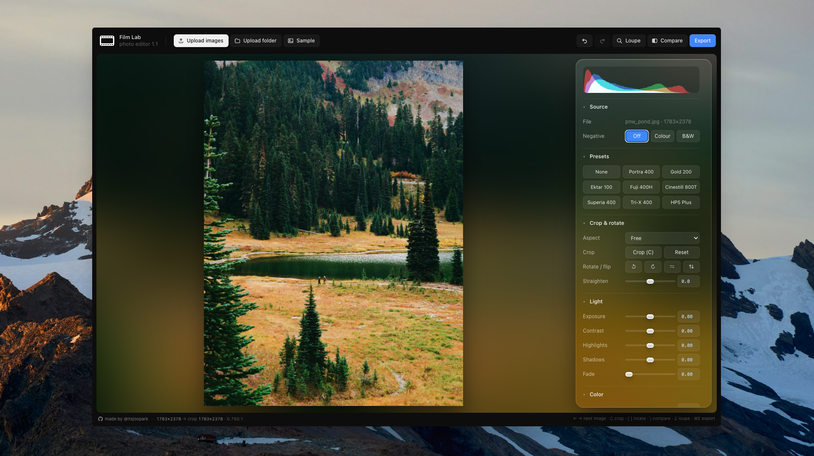
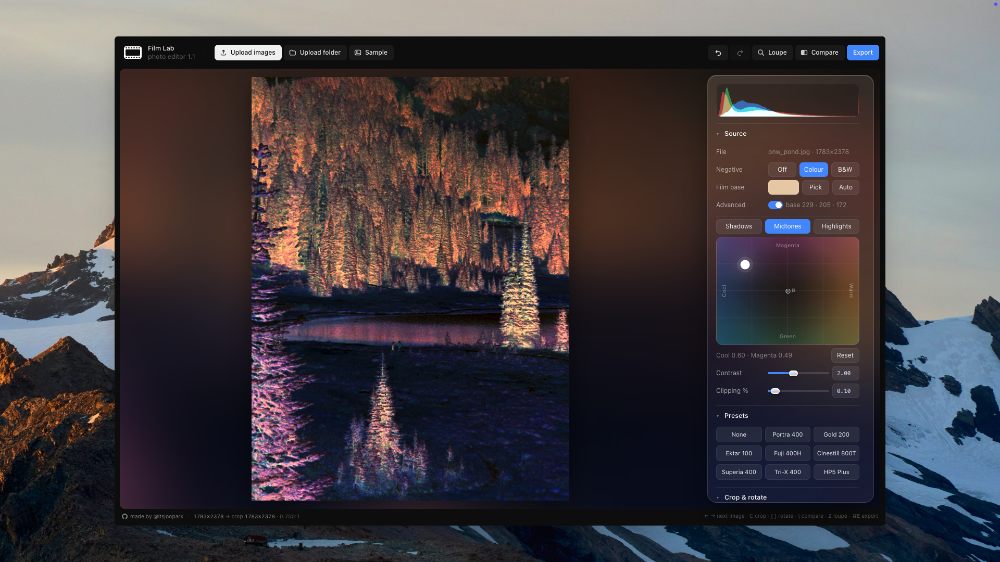

# filmlab-editor

An open-source film photo editor that runs entirely in the browser. Inspired by VSCO and Adobe Lightroom. One HTML file, no install, no server — your photos never leave your machine.





## Use it

Open `index.html` in a recent Chrome, Edge, Safari or Firefox (WebGL2 required). Drop in photos or a whole folder, or click **Sample**. It also works on phones.

## Features

- **Negatives** — colour and B&W negative inversion in density space. The film base is auto-detected from the rebate (skipping bare light from the light pad or sprocket holes) or picked by hand, imports that look like a colour negative get a prompt to invert, and **Apply look to all** shares one base and set of levels across a roll.
- **Advanced negative controls** (off by default) — a colour-balance pad for shadows, midtones and highlights: drag the node cool↔warm and green↔magenta, arrow keys nudge, double-click resets. Plus contrast and clipping.
- **Light & colour** — exposure, contrast, highlights, shadows, fade, temperature, tint, saturation, vibrance, black & white, split toning.
- **Film character** — resolution-aware grain, halation, vignette, and presets (Portra 400, Gold 200, Ektar 100, Fuji 400H, Cinestill 800T, Superia 400, Tri-X 400, HP5 Plus).
- **Generative effects** — pixelate/LED, Bayer and noise dithering, CMY halftone, gaussian splats, Voronoi glass, Kuwahara, flow lines (LIC), ink edges, ASCII, CRT.
- **Effect code editor** — a **Code editor** switch under Generative shows the selected effect's GLSL with syntax highlighting. Edit it live or copy it; errors point to the line while the last working version keeps rendering, and edits are saved in the browser and used for export.
- **Crop & rotate** — film-format aspect ratios (35mm, 645, 6×7, 4×5, XPan), straighten with auto-fit, 90° rotation, flips.
- **Rolls & batches** — drag in a folder (subfolders included, in frame order) or use **Upload folder**; per-image edits and history; apply a look to every frame. New images always start with default settings.
- **Undo that covers deletions** — removing an image, or **Clear all**, can be undone with ⌘Z, edits included.
- **Export** — JPEG, PNG, WebP, AVIF, TIFF, BMP, plus **HTML** and **React (.jsx)** with the edited image embedded; several formats and several images at once as a .zip; full-size or scaled.
- **Tools** — live histogram, 1:1 loupe (hold Z, magnifier cursor), before/after (hold \), undo/redo.
- **Works on phones** — the photo stays on top with controls scrolling below, with larger touch targets.
- **Quiet sound design** — soft cues for a few key moments (images added, negative inverted, export finished); click **Sound On** at the bottom of the panel to turn them off.

Everything is rendered in a single WebGL2 shader, so the preview is live and exports are rendered at full resolution in tiles.

## Scanning your negatives

Film Lab doesn't digitise film; it edits the images you've already captured. The usual ways in:

- **Phone or camera over a light pad.** Lay the negative flat on an even light source, shoot it straight on, filling the frame, and leave a little of the clear film edge (the rebate) in shot. A DSLR or mirrorless camera with a macro lens gives the most detail.
- **Flatbed or film scanner.** Scan as a positive with no automatic colour correction, so the orange film base stays intact.

Then drop the files in. Film Lab flags images that look like colour negatives; choose **Negative → Colour** (or **B&W**) in the Source panel. For a whole roll, get one frame right and click **Apply look to all** to share its film base and levels across every frame.

## Fonts

The UI is set in [ABC Areal](https://abcdinamo.com/typefaces/areal) by Dinamo, which is a licensed typeface and is **not included** in this repo. Without it the page falls back to system fonts. If you hold a licence, put these files in a `fonts/` folder next to `index.html` (it's git-ignored):

```
fonts/ABCAreal-Regular.woff2
fonts/ABCAreal-Medium.woff2
fonts/ABCArealMono-Regular.woff2
```

## Build

`index.html` is generated from `src/index.template.html`:

```sh
python3 build.py               # index.html — fonts linked from ./fonts/
python3 build.py --standalone  # dist/film-lab.html — fonts embedded (git-ignored, for your own use)
```

## Keyboard

| Key | Action |
| --- | --- |
| ← → | Previous / next image |
| C · Enter · Esc | Crop · apply · cancel |
| [ ] | Rotate |
| \ (hold) | Before / after |
| Z (hold) | 1:1 loupe |
| ⌘O · ⌘E | Upload · export |
| ⌘Z · ⇧⌘Z | Undo · redo (⌘Z also restores a removed image) |
| ← → ↑ ↓ (colour pad focused) | Nudge the colour balance; ⇧ for bigger steps |
| ⌘↵ (code editor) | Apply the effect code now |

## License

Code: MIT — see [LICENSE](LICENSE). The sample photo (`assets/pnw_pond.jpg`) is © Jules (@itsjoopark), all rights reserved. The page background (`assets/background.jpg`) is a photo from Unsplash, used under the Unsplash License. ABC Areal is © Dinamo and not part of this repository.
